# 在虚拟机中配置QQPilot/FishCakeQQ

本教程会帮助你在虚拟机中运行QQPilot，可以在使用同一台电脑正常工作的时候也能运行机器人。

## 检查虚拟化情况
在任务管理器 >性能 >CPU里查看。
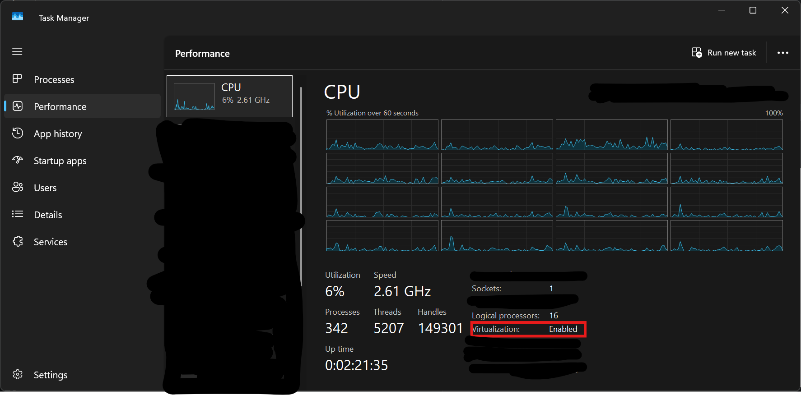

## 1.下载和安装虚拟机

 - 推荐使用[VirtualBox](https://www.virtualbox.org/wiki/Downloads)

 >本教程专注于Windows的安装。[Linux](https://www.virtualbox.org/wiki/Linux_Downloads)的部分发行版在此处有包

### 选择操作系统 
 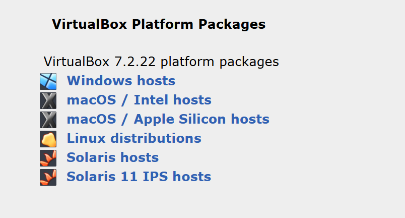

### 设置安装目录

参考你的硬盘空间选择安装位置。
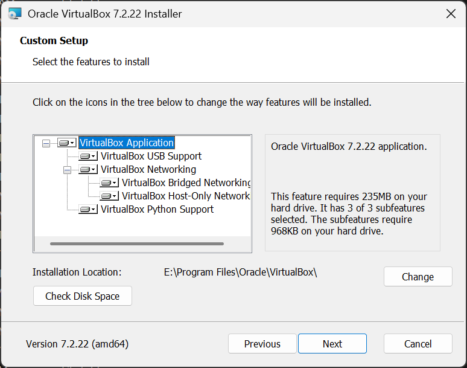
接下来可以一直下一步直到安装成功。

## 2.安装虚拟机

在此处修改语言
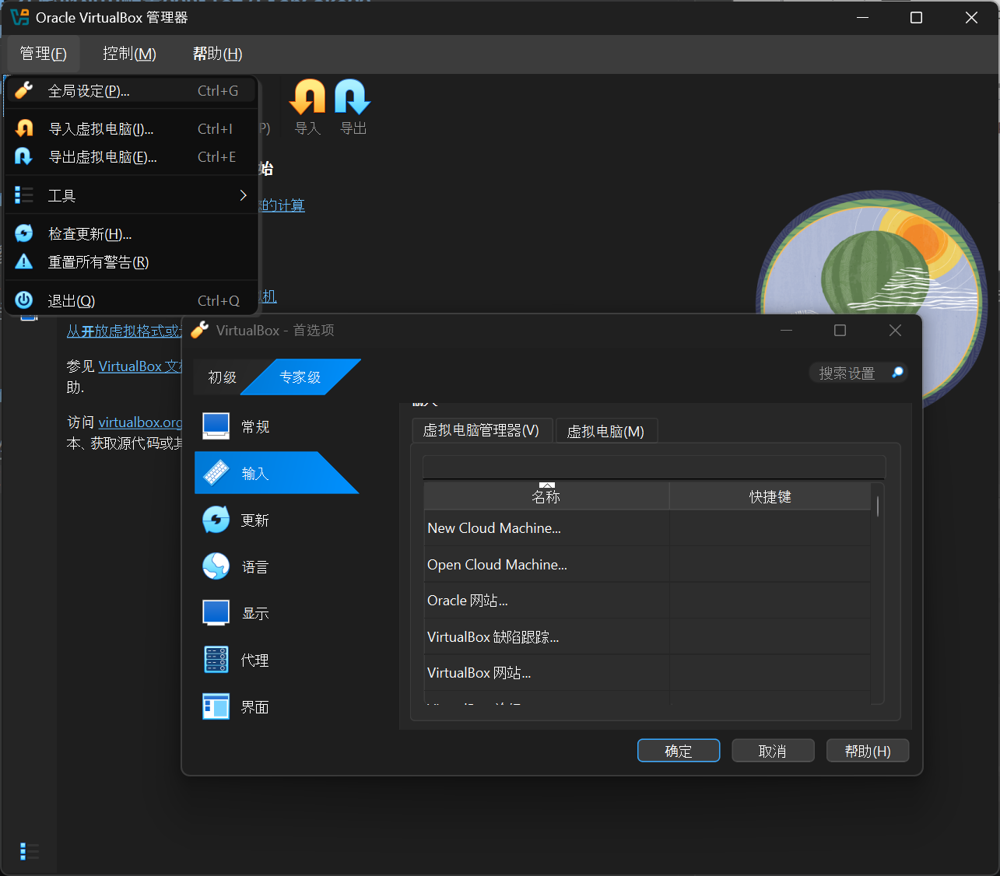
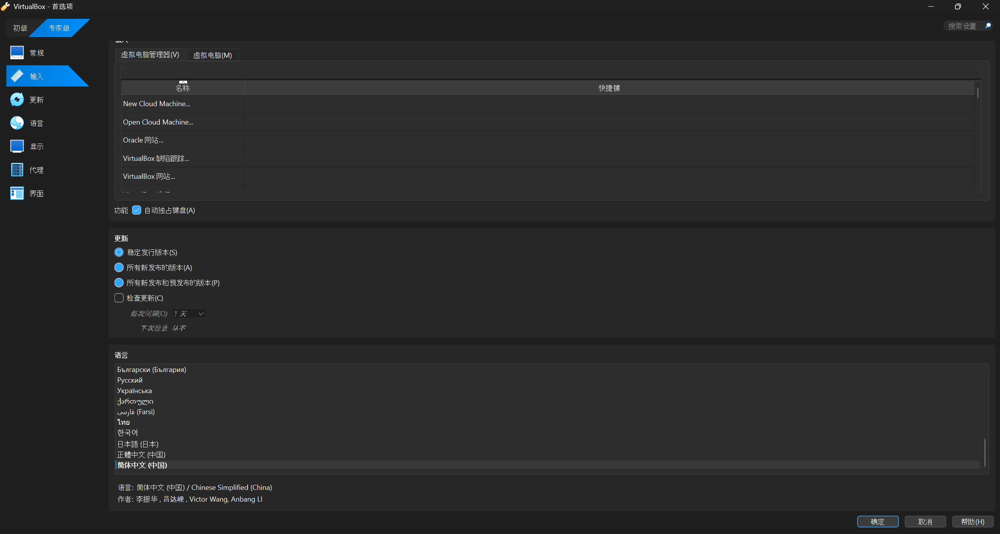

点击新建，创建新虚拟机
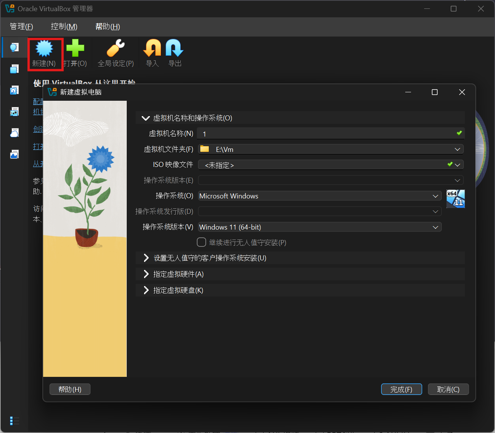

> 推荐使用Windows，QQPilot在Windows上功能最为完善。

依照希望在虚拟机上分配的配置，建议选择系统如下
|RAM/GB|存储空间|CPU核心|推荐|
|-|-|-|-|
|<1GB|≤5GB|1|Lmde / MiniOS|
|1~3GB|≤15GB|1~2|Windows 8.1|
|3~8GB|15~20GB|2~4|Windows 10 LTSC/LTSB|
|8~10GB|20~60GB|4~8|Windows 10|
|8~16GB|60GB+|4~8|Windows 11|

在这里可以下载Windows镜像https://msdn.itellyou.cn/

>请使用[正版Windows(￥1088)](https://www.microsoftstore.com.cn/windows/windows-11-home)，你可能是盗版软件的受害者。本教程不提供盗版激活Windows的任何方法。

教程使用如下。

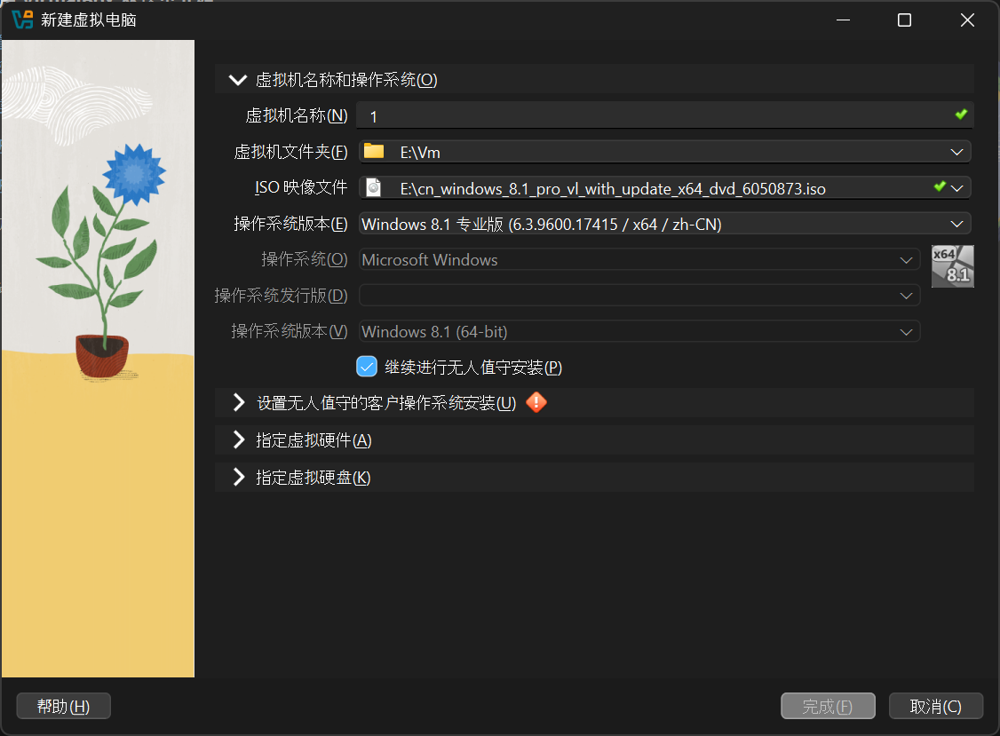
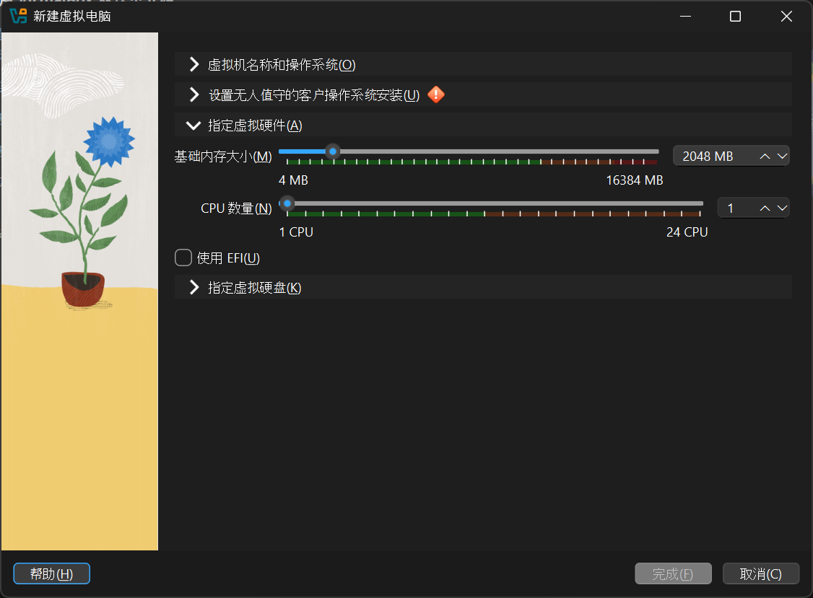
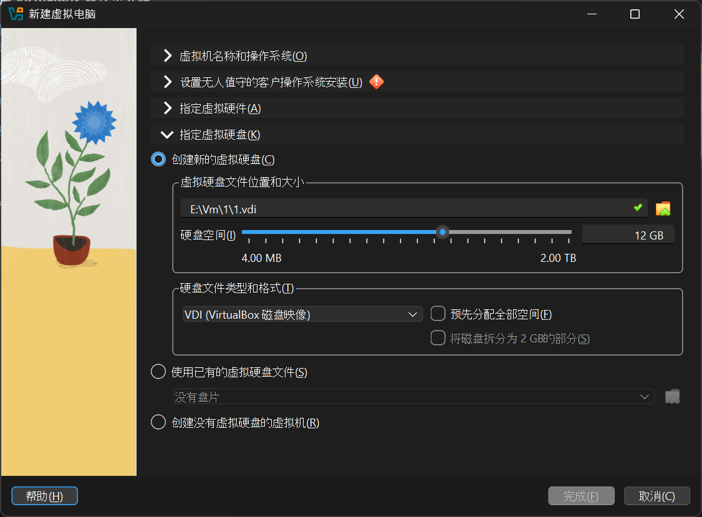

无人值守

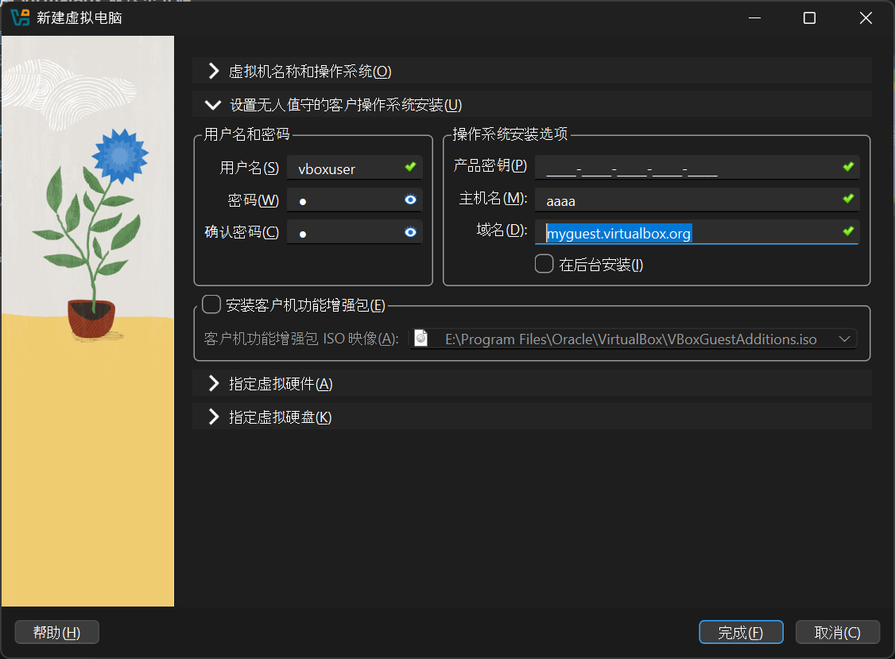

点击完成 VirtualBox会自动启动
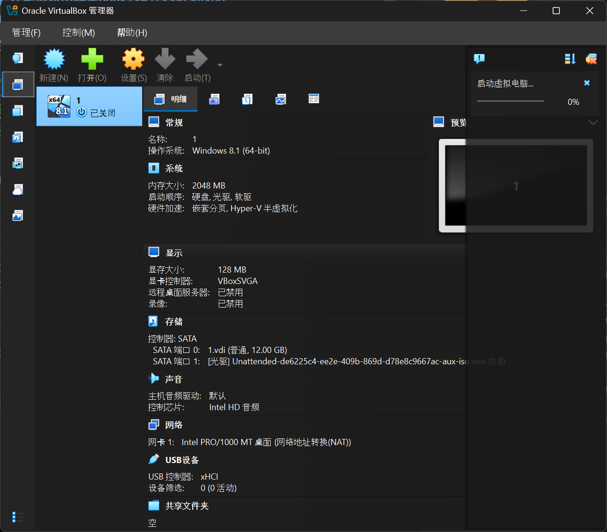
双击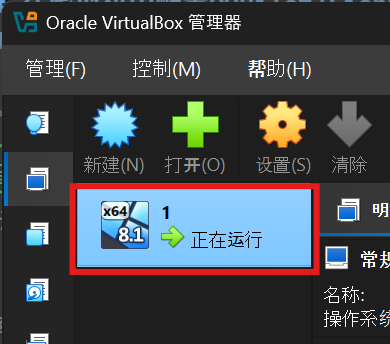 启动

 - 等待安装完成

 安装完成后，访问https://www.supermium.net/ 可以下载支持旧版本的chromium，可以直接在IE9+上访问。
 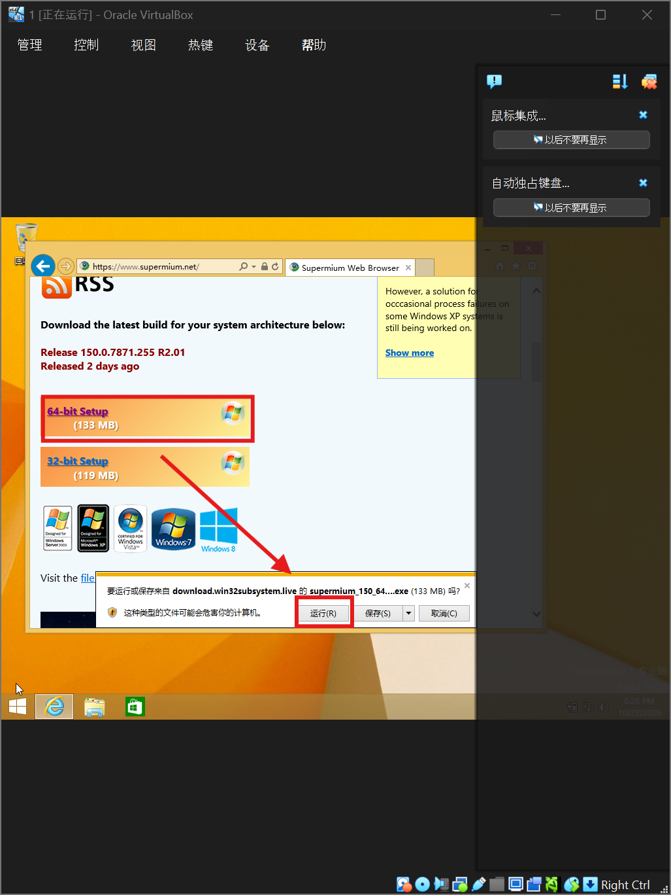

>安装完成后，就可以使用浏览器安装QQ，QQPilot实现在同一台电脑正常工作的时候也能运行机器人。